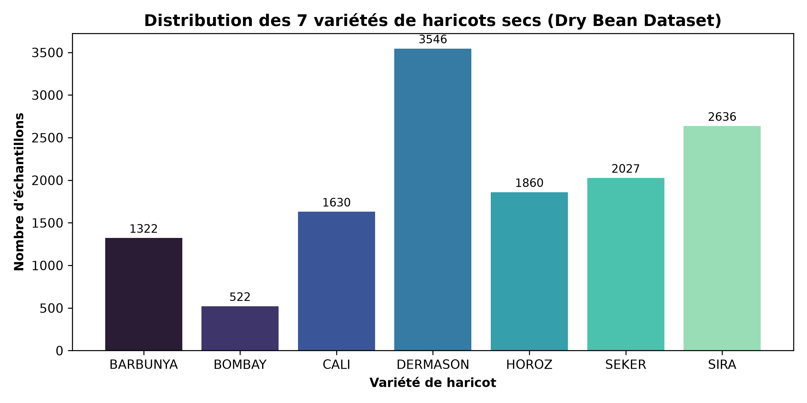
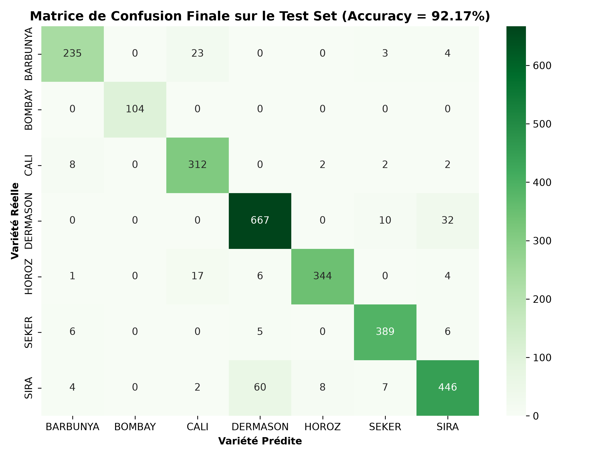

# TP Deep Learning : Réseau de Neurones Multi-Couches (MLP) avec TensorFlow / Keras

[](https://www.python.org/)
[](https://www.tensorflow.org/)
[](https://keras.io/)
[](https://scikit-learn.org/)
[-brightgreen.svg)](https://archive.ics.uci.edu/dataset/602/dry+bean+dataset)
[]()

Ce dépôt contient la réalisation complète du **Travail Pratique (TP) de Deep Learning** portant sur la conception, l'entraînement, l'optimisation, la régularisation et le déploiement de réseaux de neurones multicouches (**Multilayer Perceptron - MLP**) avec **TensorFlow / Keras**.

L'étude principale porte sur la classification des 7 variétés du dataset **Dry Bean (UCI ID: 602)**, en reprenant et approfondissant l'ensemble des étapes méthodologiques initialement abordées sur le dataset **Digits**.

---

## 📁 Structure du Dépôt

```plaintext
TP-DL/
├── TP_Dry_Bean_DL.ipynb       # Notebook principal complet & exécuté (Dry Bean Dataset)
├── TP_Digits_DL.ipynb         # Notebook complet & exécuté (Digits Dataset - référence)
├── models/
│   ├── modele_dry_bean.keras  # Modèle Keras final entraîné avec EarlyStopping
│   ├── scaler_dry_bean.joblib # StandardScaler ajusté sur les données d'entraînement
│   └── label_encoder_dry_bean.joblib # Encodeur des 7 classes de haricots
├── images/
│   ├── dry_bean_classes_distribution.png # Distribution des 7 variétés
│   ├── dry_bean_correlation_matrix.png   # Matrice de corrélation des 16 features
│   ├── history_baseline.png             # Courbes de perte et précision (Baseline)
│   ├── confusion_matrix_val.png         # Matrice de confusion sur validation
│   ├── learning_rate_comparison.png     # Comparaison des taux d'apprentissage
│   ├── regularization_dropout.png       # Impact du Dropout
│   ├── early_stopping.png               # Arrêt précoce et restauration des poids
│   └── confusion_matrix_test.png        # Matrice de confusion finale sur le test
├── requirements.txt           # Dépendances requises
└── README.md                  # Documentation complète du projet
```

---

## 🌾 1. Présentation du Jeu de Données : Dry Bean

Le jeu de données **Dry Bean** provient du dépôt officiel UCI Machine Learning Repository (`id=602`).
- **Échantillons :** 13 611 grains (13 543 après suppression des doublons stricts).
- **Caractéristiques (Features) :** 16 variables morphologiques et géométriques (aire, périmètre, compacité, facteurs de forme, excentricité, etc.).
- **Classes cibles (7 variétés) :**
  1. `BARBUNYA` (~9.8%)
  2. `BOMBAY` (~3.8%)
  3. `CALI` (~12.0%)
  4. `DERMASON` (~26.2%)
  5. `HOROZ` (~13.7%)
  6. `SEKER` (~15.0%)
  7. `SIRA` (~19.5%)



---

## 🔬 2. Méthodologie et Workflow Expérimental

Le protocole respecte scrupuleusement les bonnes pratiques du Machine Learning :

1. **Prétraitement & Évitement du Data Leakage :**
   - Séparation stratifiée : **60% Train**, **20% Validation**, **20% Test**.
   - Encodage des cibles avec `LabelEncoder`.
   - Normalisation avec `StandardScaler` ajusté **strictement sur le Train** et appliqué par transformation sur Validation et Test.
2. **Architecture du MLP Baseline :**
   - `Input(shape=(16,))`
   - `Dense(64, activation='relu')`
   - `Dense(32, activation='relu')`
   - `Dense(7, activation='softmax')`
   - Nombre de paramètres entraînables : **3 399**
3. **Fonction de Perte & Optimisation :**
   - Optimiseur : `Adam(learning_rate=0.001)`
   - Perte : `SparseCategoricalCrossentropy(from_logits=False)`
   - Métrique : `accuracy`

---

## 📊 3. Synthèse des Résultats Expérimentaux

### 3.1 Impact du Taux d'Apprentissage (Learning Rate)
| Configuration | Époques | CE Validation | Accuracy Val | F1-Macro Val | Observation |
|---|---|---|---|---|---|
| Adam ($\eta = 0.0001$) | 30 | 0.1841 | 93.91% | 0.9487 | Convergence lente mais régulière |
| **Adam ($\eta = 0.001$)** | **30** | **0.1772** | **93.98%** | **0.9506** | **Optimal : convergence rapide et stable** |
| Adam ($\eta = 0.05$) | 30 | 0.2858 | 91.10% | 0.9258 | Instabilité et sauts de gradients |

### 3.2 Optimiseurs : Adam vs SGD
| Optimiseur | Paramètres | CE Validation | Accuracy Val | F1-Macro Val |
|---|---|---|---|---|
| **Adam (lr=0.001)** | 3 399 | **0.1772** | **93.98%** | **0.9506** |
| SGD (lr=0.001) | 3 399 | 0.3746 | 91.14% | 0.9223 |

### 3.3 Taille des Lots (Batch Size)
| Taille du Lot | Mises à jour / époque | CE Validation | Accuracy Val | F1-Macro Val |
|---|---|---|---|---|
| **Batch = 16** | 508 | 0.1845 | **94.09%** | **0.9493** |
| Batch = 64 | 127 | 0.2662 | 92.51% | 0.9356 |
| Batch = Full Train | 1 | 1.9431 | 22.70% | 0.1195 |

### 3.4 Techniques de Régularisation & Fonctions d'Activation
| Configuration | Régularisation | CE Validation | Accuracy Val | F1-Macro Val |
|---|---|---|---|---|
| Référence (ReLU) | Aucune | 0.1768 | 94.09% | 0.9513 |
| L1 ($10^{-4}$) | Pénalité L1 | 0.1739 | 94.17% | 0.9522 |
| L2 ($10^{-3}$) | Pénalité L2 | 0.1742 | 94.13% | 0.9514 |
| **Dropout (0.25)** | Masquage aléatoire | 0.1797 | 94.09% | 0.9516 |
| **Activation Tanh** | Tanh | **0.1711** | **94.35%** | **0.9528** |

---

## 🏆 4. Évaluation Finale sur l'Ensemble de Test (Inédit)

Le modèle final avec `EarlyStopping` (`patience=8`, arrêt à l'époque 32, restauration de la meilleure époque 24) a été évalué **une unique fois** sur le jeu de test non vu (2 709 échantillons) :

```plaintext
============================================================
              precision    recall  f1-score   support
============================================================
    BARBUNYA     0.9252    0.8868    0.9056       265
      BOMBAY     1.0000    1.0000    1.0000       104
        CALI     0.8814    0.9571    0.9176       326
    DERMASON     0.9038    0.9408    0.9219       709
       HOROZ     0.9718    0.9247    0.9477       372
       SEKER     0.9465    0.9581    0.9523       406
        SIRA     0.9028    0.8463    0.8737       527
============================================================
    accuracy                         0.9217      2709
   macro avg     0.9331    0.9305    0.9312      2709
weighted avg     0.9224    0.9217    0.9215      2709
```

- **Accuracy Test Finale :** **92.17 %**
- **F1-Score Macro Test :** **0.9312**
- **Baseline Majoritaire (Dummy) :** **26.17 %** (Gain de **+66.00 %**)



---

## 🚀 5. Installation et Exécution Locale

```bash
# 1. Cloner le dépôt
git clone https://github.com/OussamaFETOUAKI/TP-DL.git
cd TP-DL

# 2. Installer les dépendances
pip install -r requirements.txt

# 3. Lancer Jupyter Notebook
jupyter notebook
```

Ouvrez ensuite `TP_Dry_Bean_DL.ipynb` pour visualiser l'ensemble du notebook interactif.

---

## 👨‍💻 Auteur
- **Nom :** FETOUAKI Oussama
- **Email :** oussamafetouaki2@gmail.com
- **Projet :** Travaux Pratiques de Deep Learning - EMSI
